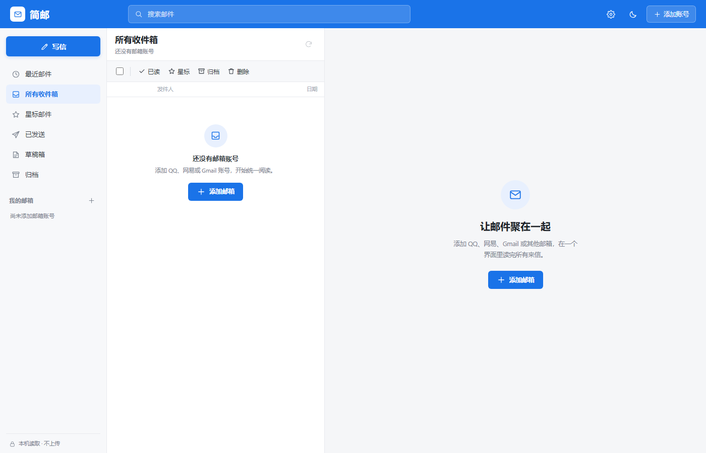
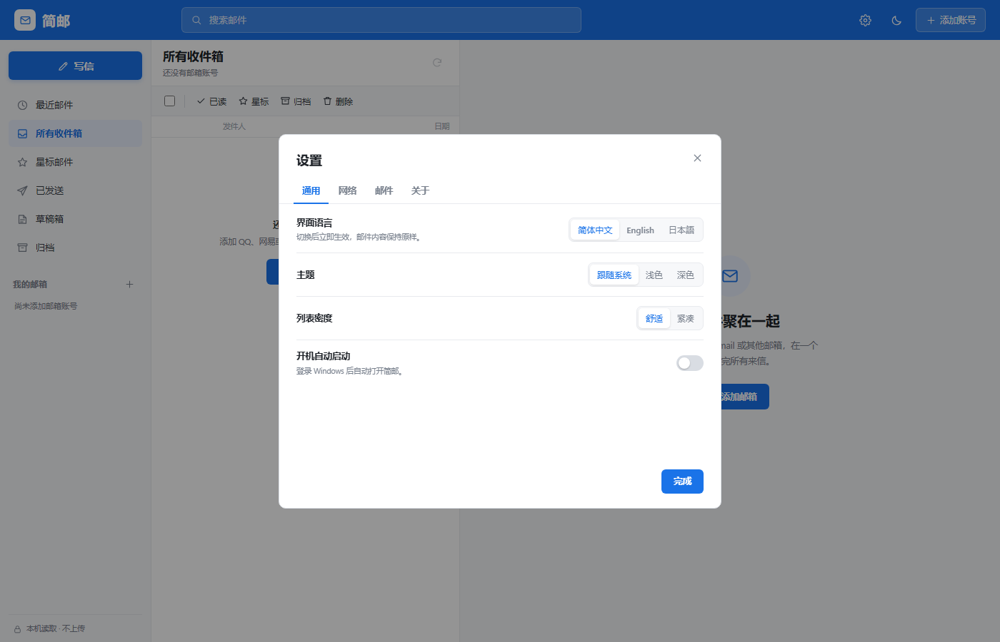
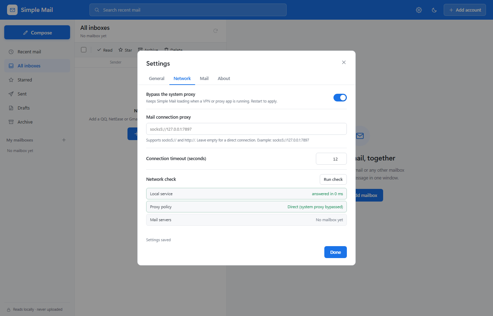
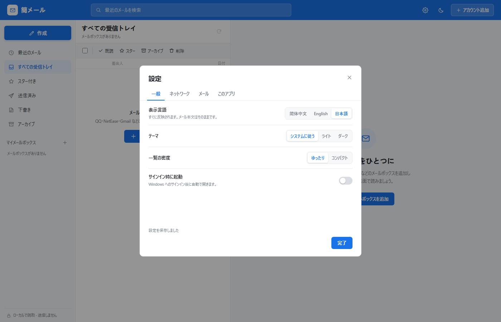
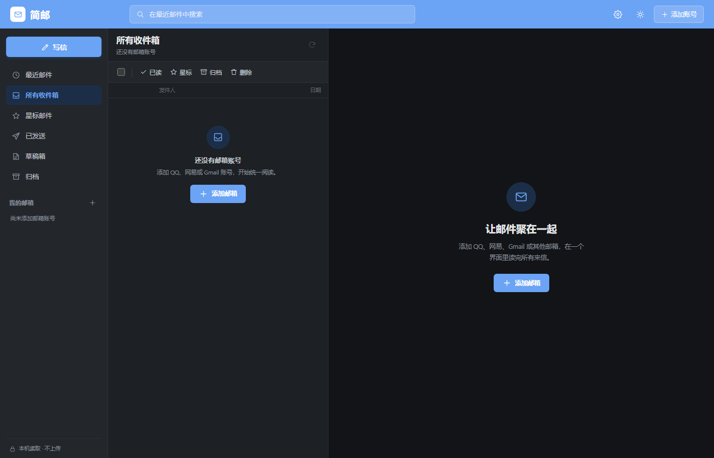

# 简邮 · Simple Mail

A read-only desktop email client for Windows that puts every IMAP mailbox into one window.

QQ Mail, NetEase 163 / 126 / Yeah, Gmail, iCloud and any other IMAP server — one list, no uploading, no "mark as read".



## Why another mail client?

Most desktop clients try to replace the web app: compose windows, calendars, contacts, sync engines, local databases. This one does a single job — **read your mail, locally, without touching it**.

- **Read-only by design.** Folders are opened with `EXAMINE` (IMAP read-only), so nothing is marked as seen, moved or deleted. There is no compose, reply, forward or send.
- **Local-first.** Message bodies are never written to disk. Every open fetches from the IMAP server over TLS and throws the bytes away when you close the message.
- **Honest about the network.** The window is served from a local HTTP server bound to `127.0.0.1` with a per-session token, and the app bypasses the Windows system proxy so it keeps working while a VPN or proxy client is running.

## Features

### Reading

- **Recent mail** — one merged view of inbox, archive, custom folders and spam across all accounts, so mail that QQ or NetEase files away into "other folders" is not invisible any more
- Per-account folder switching, paging and a "load all" button
- Search the loaded list instantly, or run a server-side IMAP search inside a folder
- HTML mail rendered to plain text (first 512 KB), remote images and scripts dropped

### Accounts

- Presets for QQ Mail, NetEase 163 / 126 / Yeah, Gmail, iCloud, plus generic IMAP with a custom host and port
- Multiple accounts in one sidebar, switch with a single click
- Optional "remember password", encrypted per user with Windows DPAPI
- Accounts live in a plain JSON file you can back up or delete

### Interface

- **Simplified Chinese / English / Japanese**, switch instantly — mail content is never translated
- **Light / dark / follow system** themes
- **Comfortable / compact** list density
- Keyboard: <kbd>Ctrl</kbd>+<kbd>K</kbd> to search, <kbd>Esc</kbd> to leave a message

### Network

- Bypasses the Windows system proxy for the local UI (fixes the white window when Clash, V2Ray or a corporate VPN is running), with an automatic retry on failure
- Optional **SOCKS5 / HTTP proxy for the IMAP connection itself** — `socks5://127.0.0.1:7897`, or just `7897`
- Configurable connection timeout
- Built-in **network diagnostics**: local service, current proxy policy, and TCP reachability of every account's IMAP port

## Screenshots

| Settings — Chinese | Network check — English |
| --- | --- |
|  |  |

| Settings — Japanese | Dark theme |
| --- | --- |
|  |  |

## How it works

```
main.cjs        Electron main process: window, proxy policy, login item, lifecycle
server.mjs      local HTTP server on 127.0.0.1 — static assets + JSON API
mail.mjs        IMAP access via imapflow, HTML→text, recent-mail aggregation
accounts.mjs    account store, password protection via Windows DPAPI
settings.mjs    validated settings store (settings.json)
i18n.mjs        request-scoped translation for server-side errors
web/            renderer: plain HTML/CSS/ES modules, no framework, no bundler
web/i18n.js     the single message catalogue shared by the UI and the service
```

- The renderer runs with `contextIsolation`, `sandbox` and no Node integration; the only API it can reach is the local JSON service, guarded by a random 256-bit token and a strict CSP.
- The service listens on a random port and rejects any request whose `Host`/`Origin` is not the exact loopback origin.
- `web/i18n.js` is imported by both the page and the main process, so a message is translated once and used everywhere.

## Requirements

- Windows 10 / 11 (macOS and Linux should work but are untested)
- Node.js **20.19+** and npm, for development only
- An **app password** from your mail provider — not your login password

## Getting started

```bash
npm install
npm start
```

Then click **Add account**, pick your provider and paste the app password:

- **QQ Mail** — Settings → Account → enable IMAP/SMTP → generate an authorization code
- **NetEase 163 / 126 / Yeah** — Settings → POP3/SMTP/IMAP → enable IMAP → generate a client password
- **Gmail** — enable 2-step verification → create an app password
- **iCloud** — create an app-specific password in your Apple account

## Packaging

Release binaries are normal Electron 32 distributions whose `resources/app.asar` contains this tree (the UI is served by the local service, so there is nothing to bundle):

```bash
npx @electron/asar pack . app.asar
```

Prebuilt installers and portable archives are attached to [Releases](../../releases).

## Where settings live

```
%APPDATA%\simple-mail-desktop\SimpleMail\accounts.json   accounts (passwords DPAPI-encrypted, optional)
%APPDATA%\simple-mail-desktop\SimpleMail\settings.json   language, theme, network options
```

Delete either file to start over. No registry keys are written; the portable build can be removed by deleting its folder.

## Privacy

- No telemetry, no analytics, no third-party server — the only outbound connections are to your own IMAP servers (and to a public DNS-over-HTTPS resolver as a fallback when QQ Mail's hostname fails to connect directly).
- Message bodies are never persisted.
- Read-only: the app cannot mark, move, delete or send anything.

## Limitations

- Read-only: no composing, replying, forwarding, attachments or calendar
- HTML is flattened to plain text
- IMAP over TLS only (port 993 by default)

## License

[MIT](LICENSE). Not affiliated with Tencent, NetEase, Google or Apple; product names are used only to describe compatibility.
